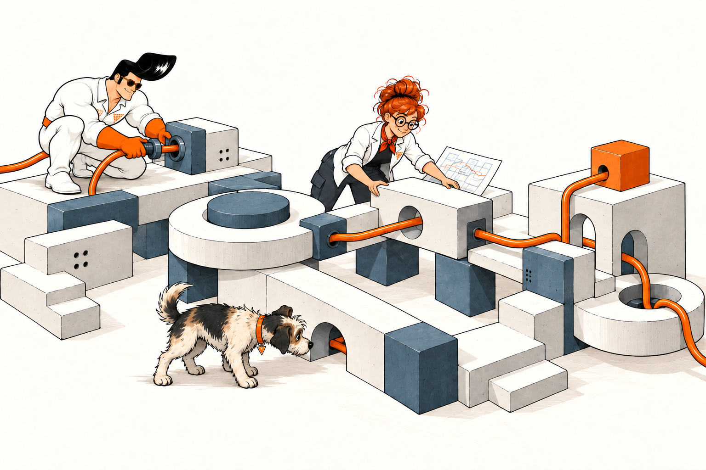
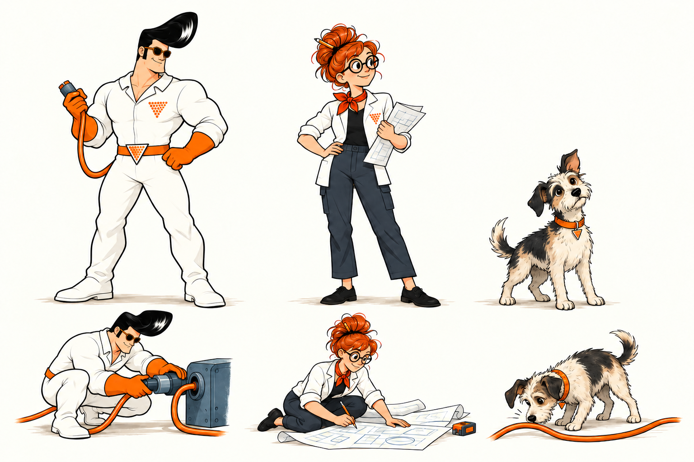

# Athega · Designmanual

**Version 0.1 · uppdaterad 23 oktober 2026.** Figurer, illustrationer, färg, typografi och layout på Athegas webbplats.

[Öppna hela manualen som PDF](athega-designmanual-0.1.pdf). GitHub visar PDF-filen direkt; om förhandsvisningen inte laddas går den att ladda ned därifrån.



## Uttrycket

Bilderna bär personligheten. Webbsidan är lugn, tydlig och enkel att använda. Illustrationerna ska visa en konkret handling som hör ihop med sidans budskap.

Athega-orange **#ff6600** och företagets logotyp är grunden. Georgia kombineras med enkel sans, vitt med varm neutral som stödfärg. En större startsidesscen och en mindre bild per tjänstesida är riktmärket.

## Tre karaktärer

Trion heter **Athegamannen, Ada och Byte**. Athegamannen följer med från [sajten från 1997](https://1997.athega.se/athega.html). Ada är uppfinnaren och Byte är hunden. Ada har en blinkning till Ada Lovelace; Byte förenar datorvärlden med hundens nyfikenhet.

[Läs deras berättelse på sajten](../../vara-figurer/index.md).



- **Athegamannen:** originalets svarta framåtsvepta frisyr, mörka glasögon, vita dräkt och orange handskar. Bred bröstkorg, breda axlar och kraftiga armar och lår ger honom en kompakt silhuett.
- **Ada:** kopparröd hårknut, runda glasögon, vit arbetsjacka och orange scarf. Tar lika mycket initiativ som Athegamannen; båda får tänka, bygga och testa.
- **Byte:** rufsig, ljus päls med mörka fält, asymmetriska öron och orange halsband. Upptäcker det andra missar genom naturligt hundbeteende.

Alla tre behöver inte vara med i varje bild. Använd karaktärsbladet som referens för utseende och proportioner. Dräkternas triangelsymboler ersätter inte företagets logotyp.

[Se den ursprungliga Athegamannen](assets/athegamannen-original.jpg).

## Gemensam berättelse för bilderna

Athega gör nya tekniska möjligheter användbara. Vi är nyfikna nog att prova och erfarna nog att bedöma resultatet. Tekniken hjälper oss att bygga; människorna ger riktning, granskar och förbättrar. Bra lösningar växer fram genom samarbete, experiment och uppmärksamhet på detaljer.

Detta är grunden för alla illustrationer, oavsett sida eller motiv. Figuren,
handlingen och resultatet ska tillsammans bära sidans budskap. Berättelsen är
ett arbetsunderlag för bildproduktion, inte extra förklarande text på sajten.

### Så gör du en ny bild utan tidigare kontext

1. Läs sidans text och formulera ett enda budskap som bilden ska stödja.
2. Fyll i [bildbriefen](bildbrief.txt): handling, synligt resultat, figurer, komposition, placering och visningsstorlek.
3. Bifoga [karaktärsbladet](assets/karaktarer.png) för identitet och [bildreferensen](../../assets/img/manual-home-maskinen-futuristisk.webp) för material, färger och detaljnivå. Öppna bilderna; filnamn räcker inte som referenser.
4. Generera med hela briefen och referenserna. Kontrollera berättelse, anatomi och läsbarhet i dator- och mobilvyn. Rätta fel och spara slutlig prompt.

### Bildvärlden

Ren europeisk serieteckning med tydliga konturer, begränsade färgfält och lätt
skuggning. Tekniken har släta vita eller elfenbensfärgade höljen, dämpat blå
moduler, glas och Athega-orange förbindelser. Den får vara fantasifull, men
funktion och samband ska vara begripliga. Håll miljön enkel och lämna luft runt
motivet. Använd vit bakgrund mot vitt, eller verklig transparens när bilden ska
fungera på olika ytor. Undvik mässingsestetik, magiska effekter och inbakad text.

Athegamannen bidrar med erfarenhet och handlingskraft, Ada med nyfikenhet och
experimentlust och Byte med uppmärksamhet på det andra missar. De två människorna
är jämbördiga och kan växla roller. Välj vilka figurer som behövs för berättelsen.

### Samma grund, olika motiv

| Sidans budskap | Möjlig handling | Vad bilden ska göra synligt |
| --- | --- | --- |
| Från idé till fungerande produkt | En instruktion matas in, en produkt kommer ut och granskas | Teknikens möjligheter och människans omdöme |
| Systemutveckling | Ada och Athegamannen fogar samman moduler efter en gemensam skiss | Delarna bildar en fungerande helhet |
| AI och experiment | En figur provar, den andra jämför resultatet med utgångspunkten | Lärande genom försök och utvärdering |
| Teknikgranskning | En förbindelse följs och en svag del undersöks | Problem upptäcks och blir möjliga att åtgärda |
| Samarbete | Figurer löser varsin del av ett gemensamt problem | Kompletterande perspektiv och gemensamt ansvar |

Exemplen är utgångspunkter, inte fasta scener. Varje bild ska ha en egen anledning
att finnas. Maskinen är ett motiv bland flera; den ska inte bli standardbild för
varje tjänst. Små fynd kan belöna den som tittar närmare, men huvudbudskapet ska
fungera även när bilden visas litet.

## Bildspråk

Ren europeisk serieteckning med tydliga bläckkonturer, begränsade plana färger och lätt skuggning. En tydlig handling per bild, luft runt motivet och få men meningsfulla detaljer. Undvik generiska kontorsmotiv, överlastade maskiner och inbakad text.

Illustrationerna är **AI-genererade**. Karaktärsbladet och stilreferensen är grund för bildproduktionen. Kontrollera anatomi, uttryck och kontinuitet i varje ny bild.

## Färg och typografi

| Del            | Värde                                       |
| -------------- | ------------------------------------------- |
| Athega-orange  | `#ff6600`, befintlig signaturfärg           |
| Text           | `#111315`, sekundär text `#363a3c`          |
| Grund          | Vitt `#ffffff` och varm neutral `#f4f2ed`   |
| Avdelare       | `#dedfdb`                                   |
| Illustrationer | Dämpad blå `#6b7f8a` som komplement         |
| Rubriker       | Georgia, fet                                |
| Brödtext       | Helvetica Neue, Segoe UI, Arial, sans-serif |

Mörk text på ljusa ytor. Fristående uppmaningar använder vita ramknappar med orange kant. Orange används som accent och som text på mörka ytor. Logotypens färg och form ändras inte.

Georgia med enkel sans är sajtens typografipar. HTML-manualens provsida har kvar möjligheten att jämföra med enbart sans-serif.

## Layout och interaktion

Sidfoten är kompakt i det smala läget: mindre logotyp, länkar i rad som bryts vid behov, kontaktuppgifter bredvid varandra och inga grupprubriker. Alla länkar och kontaktuppgifter finns kvar.

- Två responsiva lägen: bred layout över 980 px och staplad layout vid 980 px och mindre. Navigationen växlar samtidigt. Kompakta listkort och personkort kan behålla sin interna kolumnindelning där den är läsbar.
- Innehållsbredd upp till 1 216 px, sidmarginaler 24 px på större skärmar och 20 px på mobil.
- Avståndsskala: 8, 16, 24, 32, 48, 64 och 96 px.
- Tydlig introduktion, relevant illustration och snabb väg vidare till tjänsterna. Ingen tidningsliknande sidindelning.
- Kort får orange understrykning vid hovring och tangentbordsfokus, utan pilikoner.
- Diskreta övergångar på 150–250 ms, synligt tangentbordsfokus och stöd för minskad rörelse. Ingen styrning av besökarens scrollning.
- Nya bilder planeras för sin placering och mobilversion. De befintliga 3:2-bilderna visas utan att figurer kapas.

PDF-manualen innehåller även typografisk skala, sidstrukturer, komponentexempel, produktionsregler och en sammanfattning av uttrycket.

## Prova den interaktiva manualen lokalt

Öppna `docs/designmanual/index.html` från en lokal kopia av den här branchen. På macOS, från repots rot:

```sh
open docs/designmanual/index.html
```

Ingen installation eller server behövs. På avsnittet **Layout** går det att växla mellan mobil och större vy samt mellan två rubriktypsnitt. GitHub visar HTML-källan, men kör inte den interaktiva sidan i sin filförhandsvisning.

## Filer och lokal visning

- [Hela manualen, PDF](athega-designmanual-0.1.pdf)
- [Interaktiv manual, HTML-källa](index.html)
- [Provsida, HTML-källa](preview.html)
- [Bildbrief att återanvända](bildbrief.txt)
- [Sammanfattade genereringsinstruktioner](genereringsprompter.txt)
- [Färger och grundvärden i CSS](tokens.css)

Startsidan, tjänste- och företagssidorna, personalsidorna och bloggöversikten använder samma formspråk. Bloggposterna använder samma form med centrerad rubrik och ingress, vänsterjusterad brödtext och tydliga citat. Texterna och originalbilderna behålls; den gemensamma HTML-mallen är oförändrad. Kör `npm ci` och `npm start` från repots rot för att prova sajten. Själva manualen ligger separat och är undantagen från Eleventy-bygget.

## Knappar

Alla fristående uppmaningar använder samma ramknapp: vit bakgrund, mörk text
(`#111315`, 16 px, vikt 600, 24 px radavstånd) och 2 px Athega-orange ram
med 4 px hörnradie. Minst 48 px höjd och 10 × 20 px inre luft.
Vid hover används `#fff4eb`; tangentbordsfokus har en separat mörk kontur.

Relaterade knappar placeras tillsammans med 16 px mellanrum. Den viktigaste
kommer först. Länkar i löptext är understrukna. Navigation och klickbara kort
behåller sina egna beteenden.

## Maskinen på startsidan

Startsidans motiv använder en modern maskin med vita höljen, dämpat blå moduler
och Athega-orange förbindelser. Ada matar in instruktioner, Athegamannen tar emot
produkten direkt ur maskinen och Byte hittar en orange pusselbit som saknas i
produktens gränssnitt. Sambandet mellan instruktion, resultat och granskning ska
vara synligt. Behåll den rena seriestilen och undvik mässing och alkemiska effekter.

[Startsidans bild](../../assets/img/manual-home-maskinen-futuristisk.webp) ·
[Bildprompt](maskinen-futuristisk-prompt.txt)
